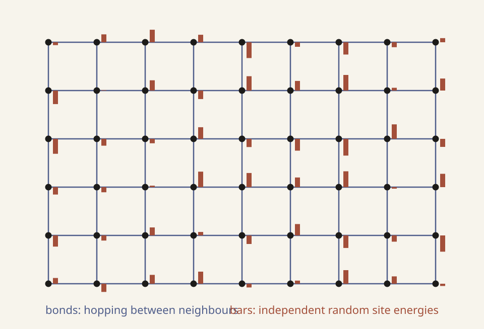
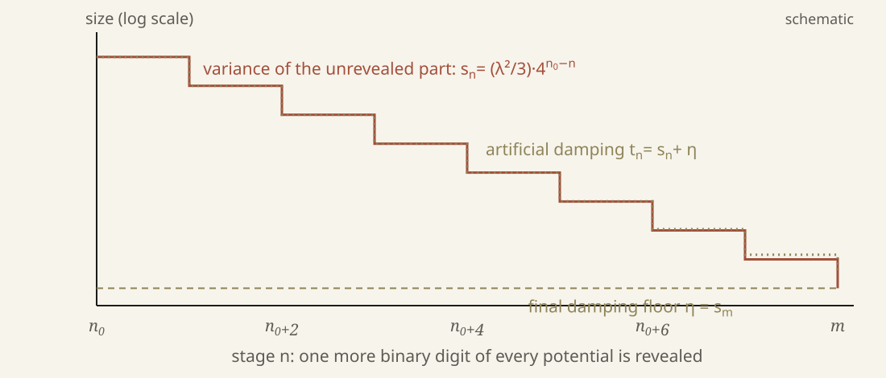

# Summary {-}

In 2000 Barry Simon asked for a proof that the Anderson model on $\mathbb Z^\nu$, $\nu\ge 3$, with independent site potentials uniform on $[a,b]$, has *purely absolutely continuous spectrum in some energy range* for suitable disorder widths $b-a$ (Problem 1 of [@Simon2000]). Localization (pure point spectrum) had been proved for this model at large disorder and near the spectral edges, but no interval of absolutely continuous spectrum had been proved on a lattice of dimension at least two; absolutely continuous spectrum at weak disorder had been proved only on trees.

In September 2026 OpenAI posted a 93-page manuscript [@OpenAI2026] whose Theorem 1.1 asserts exactly such a result: for every $d\ge3$ there is a threshold $\lambda_d>0$ such that, for $0<\lambda<\lambda_d$, almost surely a fixed open interval $I_d$ just above the bottom of the free band lies in the spectrum and carries only absolutely continuous spectrum, with nonzero weight. The manuscript has not been independently refereed.

The whole argument has been formalized in Lean 4 with Mathlib [@AndersonLean]. Theorem 1.1 itself is proved in the build, in the vocabulary of OpenAI's Lean library, and from it a statement of Simon's problem for the uniform model, in a file that imports nothing but Mathlib. The final theorem is proved without `sorry` and depends only on Lean's three standard axioms. The Lean kernel, Lean's replay checker and a second, independently written kernel accept it.

This article explains the problem, what was known, the architecture of the claimed proof, and exactly what the formal check does and does not certify. Section 6 reads the formal statement clause by clause. Throughout, each claim carries one of four labels, which the accompanying film also uses as colours:

- **proved**: proved in the peer-reviewed literature;
- **claimed**: asserted in the manuscript, not independently reviewed;
- **Lean**: checked by the Lean kernel, in the precise form stated;
- **heuristic**: an explanation, analogy or picture, which proves nothing.

Prepared by Yao Xu with AI assistance.

# 1. The question

## 1.1 The model

Let $\nu\ge1$ and let $(V_\omega(n))_{n\in\mathbb Z^\nu}$ be independent random variables, each uniform on an interval $[a,b]$. On $\ell^2(\mathbb Z^\nu)$, Simon's Example 2.1 [@Simon2000, p. 283] defines the random operator
$$
(h_\omega u)(n)=\sum_{|j|=1}u(n+j)+V_\omega(n)\,u(n),
$$
where the sum runs over the $2\nu$ nearest neighbours of $n$. The first term (the *hopping*, a discrete Laplacian up to a constant) lets a quantum particle move between neighbouring sites; the second assigns every site an independent random energy. The operator is bounded and self-adjoint, and almost surely its spectrum is the deterministic interval $[a-2\nu,\,b+2\nu]$ [@Simon2000, p. 284].

The manuscript [@OpenAI2026, eq. (1)] uses the equivalent form
$$
(H_{\lambda,\omega}\psi)(x)=-\sum_{j=1}^d\bigl(\psi(x+\mathbf e_j)+\psi(x-\mathbf e_j)\bigr)+\lambda V_x(\omega)\psi(x),\qquad V_x \text{ i.i.d. uniform on }[-1,1].
$$
The two are related by three exact changes. The disorder strength is half the width, $\lambda=(b-a)/2$. The centre $c=(a+b)/2$ of the interval shifts the whole operator by the scalar $c$. And the unitary multiplication by $(-1)^{x_1+\dots+x_d}$ turns negative hopping into positive hopping while leaving every diagonal entry unchanged [@OpenAI2026, §1.1]. So $h_\omega$ with potentials uniform on $[a,b]$ is unitarily equivalent to $H_{\lambda,\omega}+c$, and every spectral statement transfers with energies shifted by $c$. Both conventions appear below; the formal statement uses Simon's.

{#fig:lattice width=80%}

## 1.2 Spectral types

Every vector $\psi$ has a *spectral measure* $\mu_\psi$, the finite Borel measure on $\mathbb R$ with $\langle\psi,f(H)\psi\rangle=\int f\,d\mu_\psi$ for bounded Borel $f$. By Lebesgue's decomposition it splits into a pure point part (atoms, which come from eigenvectors), a singular continuous part and an absolutely continuous part (a density with respect to Lebesgue measure). The spectrum of $H$ restricted to an energy interval $I$ is *purely absolutely continuous* when every spectral measure, restricted to $I$, has a density; it is *nontrivial* there when the spectral projection $\chi_I(H)$ is nonzero.

The physical meaning is the usual one, stated here as a **heuristic**: eigenvectors with exponentially decaying amplitude are localized states that stay near where they started, while absolutely continuous spectrum corresponds to states that spread through the lattice; the RAGE theorem makes the second half precise in a time-averaged sense, though it applies equally to singular continuous states and says nothing about a rate of spreading. That eigenfunctions decay exponentially is an additional property, proved in the localization regimes below; it is not part of the definition of an atom. Anderson's 1958 paper [@Anderson1958] predicted that strong disorder localizes every state. The question of extended states is whether, in three or more dimensions and at weak disorder, some energies still carry transport.

A standard tool converts spectral type into resolvent estimates (**proved**). The Borel transform $F_\psi(z)=\langle\psi,(H-z)^{-1}\psi\rangle$ has, for Lebesgue-almost every $E$, a boundary value $\mathrm{Im}\,F_\psi(E+i0)$; this equals $\pi$ times the density of the absolutely continuous part, and the singular part lives on the set where the boundary value is $+\infty$. In particular $\mu_\psi$ is purely absolutely continuous on $I$ if $\limsup_{\varepsilon\downarrow0}\mathrm{Im}\,F_\psi(E+i\varepsilon)<\infty$ for every $E\in I$ [@Teschl2009, Theorem 3.23 and Corollary 3.24]. Spectral questions therefore become questions about the Green function $G_{xy}(z)=\langle e_x,(H-z)^{-1}e_y\rangle$ as $z$ approaches the real axis.

## 1.3 Simon's problem

Simon's list of fifteen problems for the twenty-first century [@Simon2000] opens with three about this model. Problem 1 ("Extended states") asks to prove, for $\nu\ge3$ and suitable values of $b-a$, that the Anderson model has *purely absolutely continuous spectrum in some energy range* [@Simon2000, p. 284]. Simon records the expected picture: for small $|b-a|$ a subinterval of the spectrum is purely absolutely continuous and its complement dense pure point, and the absolutely continuous interval shrinks to nothing as $|b-a|$ increases past a critical value. He adds that proving *any* absolutely continuous spectrum would cause a stir. Problem 2 asks for dense pure point spectrum in two dimensions at every disorder; Problem 3 asks for diffusive growth $\sum_n n^2|\langle e_n,e^{-itH}e_0\rangle|^2\sim ct$ where there is absolutely continuous spectrum.

Problem 1 asks for less than Simon's full picture. It asks neither for a mobility edge separating the two spectral types nor for diffusion, only for one energy range of pure absolutely continuous spectrum at suitable widths.

# 2. What was known

## 2.1 Localization

Rigorous results on $\mathbb Z^d$ before 2026 established localization (all **proved**). In one dimension the spectrum is dense pure point for every disorder [@KunzSouillard1980], as Simon notes [@Simon2000, p. 284]. In every dimension, at large disorder or at energies near the edges of the spectrum, Fröhlich and Spencer's multiscale analysis [@FrohlichSpencer1983] and its sequel by Fröhlich, Martinelli, Scoppola and Spencer [@FMSS1985] give pure point spectrum with exponentially decaying eigenfunctions, and the fractional-moment method of Aizenman and Molchanov [@AizenmanMolchanov1993] gives a second route. Simon and Wolff's rank-one theory [@SimonWolff1986] turns decay of the Green function into pure point spectrum. Elgart and Klein proved localization in an energy interval at the bottom of the spectrum at fixed disorder, for a class of single-site laws that includes the uniform one, by a multiscale analysis of finite-volume eigensystems rather than of Green functions [@ElgartKlein2019]; the manuscript uses this result for its Corollary 1.2. These are localization criteria, and none of these results gives an interval of absolutely continuous spectrum.

## 2.2 Extended states on trees

Absolutely continuous spectrum at weak disorder was first proved on the Bethe lattice, the infinite regular tree, by Klein [@Klein1994; @Klein1998] (**proved**). Aizenman, Sims and Warzel proved stability of the absolutely continuous component on trees by a different method [@AizenmanSimsWarzel2006], and Aizenman and Warzel found absolutely continuous spectrum beyond the free band through resonant delocalization [@AizenmanWarzel2013]. On high-degree trees Aggarwal and Lopatto obtained a mobility edge for a class of laws and hopping scales [@AggarwalLopatto2025] (preprint). A recent preprint of Jakšić, Last and Warzel gives a further tree argument and a conditional criterion on lattices [@JaksicLastWarzel2026].

## 2.3 Long but finite times

At weak coupling, Erdős, Salmhofer and Yau proved that the averaged dynamics becomes diffusive in a scaling limit: at times of order $\lambda^{-2-\kappa}$, for a small dimension-dependent $\kappa>0$, the expected Wigner distribution converges to a solution of a heat equation, on $\mathbb Z^d$ [@ErdosSalmhoferYau2007] and in the continuum [@ErdosSalmhoferYau2008] (**proved**). More recently Black, Drogin and Hernández studied self-consistent equations for the Gaussian Anderson model at long finite times [@BlackDroginHernandez2025] (preprint). Such results describe the dynamics on time scales that grow as $\lambda\to0$ but stay finite at each fixed coupling; spectral type is a statement about all times.

## 2.4 Why the lattice is hard

Two features separate $\mathbb Z^d$ from a tree; both are **heuristic** descriptions of the obstruction, not theorems.

*Loops.* Removing a site from a tree splits it into independent branches, so the diagonal Green function satisfies an exact recursion $G_{00}=\bigl(V_0-z-\sum_{j\sim0}G^{(0)}_{jj}\bigr)^{-1}$ whose terms on the right are independent copies of the same object. Klein's proof studies this recursion as a fixed-point equation for a distribution. On $\mathbb Z^d$ the neighbours of a removed site remain connected through many loops, the terms are correlated, and no closed equation exists.

*The approach to the real axis.* Damping $\eta$ weights the propagator by $e^{-\eta t}$, so it emphasizes times of order $1/\eta$; this is the analogy that places the finite-time results above at $\eta$ of about $\lambda^{2+\kappa}$. It is an analogy, not a deduction: a finite-time scaling limit is not a resolvent estimate. Positive-height resolvent estimates of this kind are proved directly, in a Gaussian model, by Black, Drogin and Hernández [@BlackDroginHernandez2025]. Spectral type needs the limit $\eta\downarrow0$ at fixed $\lambda$. Between the two lies the regime in which a wave scatters infinitely often, and the expansion's error terms are no longer small.

![The energy axis in the manuscript's convention. The almost-sure spectrum is $[-2d-\lambda,\,2d+\lambda]$; the free band is $[-2d,2d]$. The interval $J$ at the bottom edge carries pure point spectrum (Elgart and Klein, proved). The interval $I_d$, just above $-2d$, is where Theorem 1.1 claims purely absolutely continuous spectrum. The rest of the spectrum is not addressed. Not to scale.](figures/energy-axis.svg){#fig:axis width=100%}

# 3. The claimed theorem

**Theorem 1.1** [@OpenAI2026, Theorem 1.1] (**claimed**). There is a fixed sufficiently small number $e_2\in(0,1/100)$ such that, for every fixed integer $d\ge3$, there is $\lambda_d>0$ with the following property. Set
$$
I_d=\begin{cases}(-6+e_2/2,\,-6+e_2), & d=3,\\[2pt] -2d+(1/200,\,1/100), & d\ge4.\end{cases}
$$
Then for every fixed $0<\lambda<\lambda_d$, almost surely
$$
I_d\subset\sigma(H_{\lambda,\omega}),\qquad \chi_{I_d}(H_{\lambda,\omega})\,\ell^2(\mathbb Z^d)\subset\mathcal H_{\mathrm{ac}}(H_{\lambda,\omega}).
$$
In particular the spectral restriction to $I_d$ is purely absolutely continuous and $\chi_{I_d}(H_{\lambda,\omega})\ne0$. For $d\ge4$ one may take $\lambda_d=\sqrt3\,2^{-n_*(d)}$, where $n_*(d)$ is the least index satisfying a finite-matrix probability criterion [@OpenAI2026, Definition 8.2]; for $d=3$ the proof gives an existential threshold.

Four features of the statement matter later.

1. The interval $I_d$ does not depend on $\lambda$. It lies just above the bottom $-2d$ of the free band, inside the almost-sure spectrum $[-2d-\lambda,\,2d+\lambda]$.
2. The probability-one event may depend on the fixed coupling, and no estimate is uniform as $d\to\infty$ [@OpenAI2026, §1.1].
3. The threshold is not effective: for $d\ge4$ its definition is explicit but no numerical bound is supplied, and for $d=3$ even the number $e_2$ is only known to exist.
4. The theorem is stated for the uniform law. Its proof writes each uniform variable as a series of fair binary signs, an exact property of the uniform distribution (Section 4.2).

The manuscript's Corollary 1.2 combines Theorem 1.1 with Elgart and Klein's edge localization [@ElgartKlein2019] at the same coupling: an interval $J_{d,\lambda}$ at the bottom of the spectrum carries pure point spectrum while $I_d$ carries absolutely continuous spectrum (Figure 2). This corollary is **claimed** and was not formalized.

# 4. The architecture of the proof

This section follows the manuscript's own outline [@OpenAI2026, §1.3] and its Sections 2–9. Every statement in it is **claimed** unless marked otherwise; the explanatory remarks marked **heuristic** are ours. The goal is that a reader can locate any stage in the manuscript and know what it is for.

{#fig:map width=100%}

## 4.1 The target: a finite-volume certificate

The whole construction aims at one finite statement [@OpenAI2026, Proposition 2.1]. Fix $E\in I_d$ and a small $\lambda$, choose scales
$$
n_0=\lfloor\log_4(3/\lambda^2)\rfloor,\quad m\ge4n_0,\quad s_n=\tfrac{\lambda^2}{3}\,4^{\,n_0-n},\quad \eta=s_m,\quad t_n=s_n+\eta,
$$
and work on the periodic torus $\mathbb T_L=(\mathbb Z/L\mathbb Z)^d$ with $L=4^{20m}$ and $N=L^d$ sites [@OpenAI2026, eq. (3)]. The certificate is an event $\mathcal S_m$, with probability tending to one as $m\to\infty$, on which there are a set $A$ of at least half the sites and complex numbers $r_i$, $i\in A$, with $|r_i|\le C$ and $c\le\mathrm{Im}\,r_i\le C$, such that
$$
\widehat G=\bigl(H_m-E-\eta\,\mathrm{diag}_A r\bigr)^{-1}\ \text{exists and}\ \mathrm{Im}\,\widehat G_{ii}\ge c\quad(i\in A).
$$
Here $H_m$ is the periodic Anderson matrix with the *true* potentials at every site. In words: after adding a tiny complex damping term $\eta\,r_i$, with $\eta\asymp4^{-m}$ and $\mathrm{Im}\,r_i\ge c$, on at least half of the sites, the diagonal of the Green function still has imaginary part bounded below, uniformly in the volume. A lower bound on $\mathrm{Im}\,G_{ii}$ as the damping goes to zero is the signature of absolutely continuous spectrum (Section 1.2); Section 9 makes this precise.

The construction may use auxiliary randomness and may choose $A$ and $r$ adaptively; only the true potential vector must keep its product law.

## 4.2 Revealing the potential one binary digit at a time

A uniform variable on $[-\lambda,\lambda]$ is a sum of independent fair signs [@OpenAI2026, eq. (4)]:
$$
\lambda V_i=\sum_{k\ge1}\lambda\,2^{-k}\varepsilon_{i,k},\qquad \mathbb P(\varepsilon_{i,k}=\pm1)=\tfrac12 .
$$
After the first $h$ signs at a site are known, the unknown remainder is uniform on $[-\lambda2^{-h},\lambda2^{-h}]$ with variance $\lambda^2 4^{-h}/3$. With $h=n-n_0$ digits known, this variance is exactly $s_n$. The construction starts from the free operator, with every potential set to zero, and reveals the signs stage by stage. At stage $n$ it does not use the unknown remainder at all: it replaces it by a complex diagonal self-energy $t_n\,r_i$, whose imaginary part provides damping, of the same size $t_n\approx s_n$ as the remainder's variance.

As a **heuristic**: a small random term of variance $s$ shifts the averaged resolvent, to second order, by the self-energy $s\,G_{ii}$. The stage-end condition $r_i=g_{ii}$ (Section 4.3) is a self-consistent equation of this type, so the damped matrix is a mean-field stand-in for the part of the disorder not yet revealed. Each revealed digit replaces part of the artificial damping by true randomness. The damping can never vanish, but by the last stage it has fallen to $t_m=s_m+\eta=2\eta$, a final residual sweep brings it to $\eta=s_m$, and the potentials at all remaining sites are their complete true values.

{#fig:digits width=85%}

## 4.3 The matrix state and the three controls

At every moment the sites are split into *active* sites $A$, which still carry damping, and *terminal* sites $T$, which carry their complete true potential and have been removed by a Schur complement at the real energy $E$; let $M$ be the resulting real symmetric matrix on $A$ [@OpenAI2026, §2.3]. With $p_i=\mathrm{Im}\,r_i>0$ and a scale $t$, the state is
$$
g=(M-t\,\mathrm{diag}\,r)^{-1},\quad h=\sqrt t\,g,\quad K_{ij}=h_{ij}^2,\quad F_{ij}=|h_{ij}|^2,\quad q_i=\mathrm{Im}\,g_{ii}.
$$
The resolvent identity gives the *Ward identity* [@OpenAI2026, eq. (5)]
$$
h\,\mathrm{diag}(p)\,h^*=\mathrm{Im}\,g,\qquad Fp=q .
$$
(Indeed $g-g^*=g\bigl((g^*)^{-1}-g^{-1}\bigr)g^*=2it\,g\,\mathrm{diag}(p)\,g^*$, since $M$ is real symmetric.) Three quantities are controlled at every stage boundary [@OpenAI2026, §2.4]; during a stage $r$ stays frozen, and a diagonal lag between $r_i$ and $g_{ii}$ develops, which the reset at the end of the stage removes:

- **The squared-entry matrix $K$.** Since $\partial g_{ii}/\partial r_j=t\,g_{ij}^2=K_{ij}$, the linearization of the self-consistency equation $r=(g_{ii}(r))_i$ is $I-K$. Keeping $\|K\|\le1/3$, together with a small diagonal lag and a bound on the inverse in a spatial norm, makes the stage-end reset solvable [@OpenAI2026, Propositions 7.4–7.5]. The bounds on $K$ and on the Laplacian below are asserted at stage boundaries, not at every intermediate step of a clearing.
- **Row fourth moments.** The bound $\max_i\sum_j|h_{ij}|^4\le t^{1+\delta}$, with $\delta=0.01$, prevents the Ward mass of a row from concentrating at a few sites, so that no single update can move much.
- **The Ward Laplacian.** By the Ward identity,
$$D=\mathrm{diag}(pq)-\mathrm{diag}(p)\,F\,\mathrm{diag}(p),\qquad D(f)=\tfrac12\sum_{i,j}p_ip_jF_{ij}\,|f_i-f_j|^2,$$
is a graph Laplacian with nonnegative weights. Its inverse form $X=D^+$ on neutral charges is compared with the lattice Laplacian $\Lambda$ by two-sided bounds [@OpenAI2026, eq. (7)], which give a spatial energy norm for adding up many small local changes.

The manuscript notes related controls in the work of Black, Drogin and Hernández and, earlier, of Erdős, Knowles, Yau and Yin on random band matrices [@BlackDroginHernandez2025; @ErdosKnowlesYauYin2013]. Here the Ward identity gives an exact Laplacian for each current matrix state.

## 4.4 Initialization: the free resolvent near the band bottom

The construction starts with every site active and every potential zero, so $g=(H_0-E-tr)^{-1}$ is a function of the free operator alone. The scalar $r$ solves $r=N^{-1}\sum_k\bigl(a(k)-E-tr\bigr)^{-1}$, where $a(k)=-2\sum_j\cos k_j$ is the free dispersion [@OpenAI2026, Proposition 3.6]. The interval $I_d$ sits just above the band minimum $-2d$, where the change of variables $x_j=2\sin(k_j/2)$ turns $a(k)+2d$ into $|x|^2$ and the density of states is smooth and positive [@OpenAI2026, Lemma 3.5]. Fourier estimates there give the three controls with room to spare: $\|K\|\le1/10$, row fourth moments at most $\tfrac1{10}t^{1+\delta}$, and the Laplacian comparisons.

## 4.5 Ordinary sweeps and pending sites

A stage reveals one more digit at every active site, in orders drawn from auxiliary randomness. Each update is a local rank-one change, analysed by splitting a site into two "ports" and deleting one [@OpenAI2026, §4.1–4.2]; Proposition 4.8 estimates the changes of $K$, of the Laplacian and of the diagonal lag $g_{ii}-r_i$.

A union bound over all sites at all scales would be too expensive, so updates are tested on finite tiles, with stopping rules that halt a trial at the first violated budget [@OpenAI2026, §5]. If a tile trial fails, its numerical changes are rolled back, but every answer it obtained stays in the record, and *all* active sites of the tile are marked **pending**. At a pending site the construction stops relying on the guarantee that its true digits beyond the revealed prefix are unqueried; its later updates use independent auxiliary digits. Proposition 5.8 gives the endpoint of an ordinary sweep.

The bookkeeping of what is known is formal: a lemma on conditional freshness [@OpenAI2026, Lemma 2.2] shows that, given the retained history of all queries and decisions, every unqueried true digit still has its fair-sign law, also at stopping times.

![The three committed site states [@OpenAI2026, Figure 1, redrawn]. Active sites keep artificial damping. A failed trial marks a coupled site pending; a successful clearing turns sites into permanent terminals with their complete true potentials.](figures/site-states.svg){#fig:states width=85%}

## 4.6 Clearing small pending components

At later scales, small connected components of pending sites are removed [@OpenAI2026, §6]. A unitary scattering matrix records the interaction between the component's core and its exterior; the range of its cross block contains the directions through which completing the core can act on the surviving sites (Lemma 6.1). Unitarity bounds the size of that change, so if the projection onto this range has small diagonal entries, completing the core changes every surviving row only a little. A spatial estimate controls the whole range even when its nonzero singular values are tiny (Lemma 6.2). Regularized projection weights then guide the exposure of true residuals at exterior sites; a negative drift bounds the number of exposures (Lemmas 6.4 and 6.5), and stopped martingale estimates bound their accumulated effect, including the first violating update. Proposition 6.6 states the preparation of a small component. After a successful clearing the core and the exposed exterior sites become committed terminals; a failed clearing rolls back, keeps every answer and marks its sites pending.

## 4.7 Assembly and reset

A deterministic induction adds the committed changes of all clearings at one scale (Proposition 7.3), controls the geometry of terminal sites, keeps at least half the sites active, and closes the stage with a *diagonal reset* (Proposition 7.4): a small correction restores $r_i=g_{ii}$, which is possible because $I-K$ is invertible. Proposition 7.5 shows that the bounds of Section 4.3 hold uniformly at every stage boundary.

## 4.8 Failure histories and the cutoff

A probabilistic induction tracks the retained information and bounds failures at deterministically ordered labels by successive conditioning [@OpenAI2026, §8]. A pending site that survives yields either a recent failure label or many separated older witnesses with distinct leaf labels (Proposition 8.1), and either is unlikely. Clearings run through stage $J=\lfloor m/2\rfloor$; the construction aborts if a site is still pending there, and with high probability none is. A final sweep then inserts the entire remaining true suffix at every active site. These sites keep the final damping $\eta$, but their real potentials are now their complete true values, which is the certificate of Section 4.1. For $d\ge4$, Definition 8.2 and Proposition 8.3 turn the same criterion into the intrinsic threshold $n_*(d)$.

Dimension enters through three estimates [@OpenAI2026, §1.3]: a Fourier bound that keeps the three-dimensional interpolation gains in every dimension, a size exponent for pending components inversely proportional to $d$, and a dimension-dependent separation of scales in the history recursion.

## 4.9 From the certificate to absolute continuity

Section 9 of the manuscript proves a conditional transfer [@OpenAI2026, Proposition 9.2]: if, for every fixed $E\in I$ and all large $m$, a certificate of the form above exists with probability at least $1/2$, then almost surely $I\subset\sigma(H)$, $\chi_I(H)\ell^2\subset\mathcal H_{\mathrm{ac}}(H)$ and $\langle e_0,\chi_I(H)e_0\rangle>0$. The argument has four steps.

1. *A true finite-volume bound.* The certificate concerns a damped matrix; to compare it with the ordinary resolvent of the true operator, a narrow spectral projection of the true operator isolates the nearby eigenvalues, whose effect is bounded by the projection's rank. Own-site averaging bounds the expected rank. The averaging lemma [@OpenAI2026, Lemma 9.1] states that if a site's potential $s$ has a bounded density $\rho$, then $\int\rho(s)\,\mu_s(B)\,ds\le\|\rho\|_\infty|B|$ for the spectral measure $\mu_s$ of that site; this is in the tradition of Simon and Wolff's rank-one theory [@SimonWolff1986].
2. *Infinite volume.* The bound passes to the infinite lattice and gives a positive expectation for a bounded function of $\mathrm{Im}\,G_{00}(E+i0)$.
3. *Propagation of positivity.* At almost every fixed energy, ergodicity and rank-one changes of a site potential propagate boundary positivity to every site, almost surely.
4. *Purity.* Conditioning on the operator with one site removed produces an exceptional energy set that does not depend on that site's potential. Absolute continuity holds off this set, and spectral averaging removes the mass on the set itself.

Theorem 1.1 follows: for $d=3$ from Proposition 2.1, whose certificate has probability tending to one; for $d\ge4$ directly from the threshold criterion [@OpenAI2026, Proof of Theorem 1.1].

# 5. Status

## 5.1 The manuscript

The manuscript is dated September 23, 2026 and was published in the repository `openai/math` (commit `adc7f124`) [@OpenAI2026]. Its abstract says that it settles the purely absolutely continuous energy-range question in Simon's Problem 1 for this model. To our knowledge it has not been refereed or independently reviewed. Everything in Sections 3 and 4 above is therefore **claimed**, with one qualification: Theorem 1.1, in the vocabulary of OpenAI's library, and the Mathlib-only statement of Simon's problem derived from it are proved in Lean, as described next. That check covers the formal proof, not the text of the manuscript; Section 5.3 states its limits.

## 5.2 What the Lean formalization checks

The repository `anderson-ac-lean4` [@AndersonLean], version 1.0.0 (commit `38116e1a08b2b3427f24d6043fffd5560fba6905`, October 14, 2026), contains 853 Lean modules, about 212,000 lines, built on Lean 4.34.1, Mathlib at commit `d13f23b7` and OpenAI's Lean library at commit `adc7f124`. Version 1.0.1 changes only comments and adds a non-vacuity file; the proofs are those of 1.0.0.

Its final theorem is
```lean
theorem AndersonAC.Blueprint.anderson_challenge : AndersonChallenge.Statement
```
where `AndersonChallenge.Statement` is defined in `AndersonAC/Challenge.lean`, a file whose only import is Mathlib. Section 6 reads it clause by clause. The following checks were run on a fresh clone of the public tag `v1.0.0`; their record is `docs/verification.md` at tag `v1.0.2` (commit `51e7e5f`), and the non-vacuity file was added in `v1.0.1` (**Lean**):

| Check | Result |
|---|---|
| Clean build of the library | succeeds |
| `#print axioms` for the final theorem and the 17 package theorems | `propext`, `Classical.choice`, `Quot.sound` only; no `sorryAx` |
| Replay of every declaration by Lean's `leanchecker --fresh` | accepted |
| Comparison of the proved statement with an independent copy of `Challenge.lean`, checked by the Lean kernel and by nanoda, an independently written type checker | accepted |
| Control: the same comparison with `3 ≤ d` changed to `2 ≤ d` | rejected, as it must be |
| Non-vacuity: an i.i.d. uniform family exists for every $a<b$, and the theorem then yields an operator, a vector and a spectral measure with nonzero mass on the interval | proved, standard axioms only |

The proof follows the manuscript's architecture: its packages correspond to Sections 2–9 (Appendix A), and the intermediate declaration `AndersonAC.Blueprint.PaperTheorem` is Theorem 1.1 in the vocabulary of OpenAI's library, including the fixed window $I_d$ and, for $d\ge4$, the finite-box threshold. Formalizing every step turned up one literal omission in the manuscript: Lemma 6.2 needs the damping scale to satisfy $t\le1$, which holds wherever the lemma is used, and the formal statement adds that hypothesis. No other discrepancy between the manuscript's statements and what the proof needed was recorded.

## 5.3 What the Lean check does not certify

1. **The meaning of the statement.** The kernel proves `Statement` as written. That `Statement` is Simon's problem is a judgement about definitions, which a reader must make by reading `Challenge.lean`; Section 6 sets out that reading. An internal clause-by-clause review of the statement against Simon's text, the problem's catalogue entry and the manuscript found it faithful, with the notes recorded in Section 6.3; it is not an independent peer review.
2. **The trusted base.** Mathlib's definitions of $\ell^2$, the spectrum, independence, uniform laws and absolute continuity are taken as correct, as are the Lean kernel and its independent re-implementation used above.
3. **The manuscript's text.** The formal proof is a separate proof that follows the manuscript's plan. It certifies the theorem, not the correctness of every sentence in the 93 pages. A reader who wants to know whether a particular argument in the text is right should read the text, or the corresponding Lean module.
4. **The full Theorem 1.1 in the exported type.** The exported `Statement` lets the interval depend on the width $b-a$, while Theorem 1.1 fixes it. The fixed interval and the threshold specification are carried by the internal declarations `PaperTheorem` and `SimonProblem`, which are proved in the same build but are phrased in OpenAI's library vocabulary and were reviewed only at source level.
5. **Everything outside Theorem 1.1:** Corollary 1.2, the diffusion question, other single-site laws and two dimensions (Section 7).

## 5.4 Ledger

| Claim | Status |
|---|---|
| Spectrum is $[a-2\nu,b+2\nu]$ a.s.; pure point in $d=1$; pure point at large disorder or near the edges | **proved** (Section 2.1) |
| Pure absolutely continuous spectrum at weak disorder on the Bethe lattice | **proved** [@Klein1998] |
| Diffusion at times $\lambda^{-2-\kappa}$ on $\mathbb Z^d$ | **proved** [@ErdosSalmhoferYau2007] |
| Theorem 1.1 and Corollary 1.2 of the manuscript | **claimed** (unrefereed manuscript, 2026) |
| `AndersonChallenge.Statement` (Simon's Problem 1, uniform law, $d\ge3$) | **Lean** (v1.0.0, standard axioms) |
| `PaperTheorem` (Theorem 1.1 with fixed $I_d$ and threshold), in OpenAI's library vocabulary | **Lean**; statement reviewed at source level only |
| The mean-field reading of the damping (Section 4.2) and the loop picture (Section 2.4) | **heuristic** |

# 6. The formal statement, clause by clause

```lean
def Statement : Prop :=
  ∀ d : ℕ, 3 ≤ d → ∃ δ : ℝ, 0 < δ ∧ ∀ a b : ℝ, a < b → b - a < δ →
    ∃ E₁ E₂ : ℝ, E₁ < E₂ ∧
      ∀ (Ω : Type) [MeasureSpace Ω] [IsProbabilityMeasure (volume : Measure Ω)]
        (V : (Fin d → ℤ) → Ω → ℝ),
        (∀ n, Measurable (V n)) → iIndepFun V volume →
        (∀ n, pdf.IsUniform (V n) (Set.Icc a b) volume volume) →
        ∀ᵐ ω, (∃ T, IsAndersonOperator (fun n => V n ω) T) ∧
          ∀ T, IsAndersonOperator (fun n => V n ω) T →
            (∀ E ∈ Set.Ioo E₁ E₂, (E : ℂ) ∈ spectrum ℂ T) ∧
            (∀ v μ, IsSpectralMeasure T v μ → μ.restrict (Set.Ioo E₁ E₂) ≪ volume) ∧
            (∃ v, (∃ μ, IsSpectralMeasure T v μ) ∧
                  ∀ μ, IsSpectralMeasure T v μ → μ (Set.Ioo E₁ E₂) ≠ 0)
```

## 6.1 The two auxiliary definitions

`IsAndersonOperator V T` says that the bounded operator `T` on `lp (fun _ : Fin d → ℤ => ℂ) 2`, Mathlib's $\ell^2(\mathbb Z^d)$, acts by
$$(Tu)(n)=\sum_{i<d}\bigl(u(n+e_i)+u(n-e_i)\bigr)+V(n)\,u(n)$$
for every vector and every site. This is Simon's $h_\omega$ with positive hopping and no normalization. For a bounded potential such an operator exists and is unique; the repository proves both, and self-adjointness.

`IsSpectralMeasure T v μ` says that `μ` is a finite Borel measure on $\mathbb R$ whose moments are $\int t^k\,d\mu=\mathrm{Re}\,\langle v,T^kv\rangle$ for all $k$. For a bounded self-adjoint operator the spectral measure of $v$ has these moments; conversely the moments grow at most geometrically, so they determine the measure. Defining spectral measures by moments keeps the statement inside the pinned Mathlib's vocabulary, which has no construction of spectral measures for bounded self-adjoint operators on infinite-dimensional spaces, and makes "every spectral measure" refer to exactly one measure.

## 6.2 The clauses

| Clause in Lean | Mathematical reading | Source |
|---|---|---|
| `∀ d, 3 ≤ d → ∃ δ > 0` | in every dimension $d\ge3$ there is a width bound $\delta(d)$ | "$\nu\ge3$ and suitable values of $b-a$" [@Simon2000] |
| `∀ a b, a < b → b - a < δ` | for every interval $[a,b]$ of width below $\delta$ | $\lambda=(b-a)/2<\lambda_d$ |
| `∃ E₁ E₂, E₁ < E₂` | there is a nonempty open energy interval | "some energy range"; here $(E_1,E_2)=c+I_d$ |
| `∀ Ω … V`, measurable, `iIndepFun`, `pdf.IsUniform … (Set.Icc a b)` | for any probability space carrying mutually independent potentials, each uniform on $[a,b]$ | Example 2.1 [@Simon2000] |
| `∀ᵐ ω` | almost surely | Theorem 1.1 |
| `∃ T, IsAndersonOperator …` | the operator exists | (implicit in the sources) |
| `∀ E ∈ Ioo E₁ E₂, E ∈ spectrum ℂ T` | the interval lies in the spectrum | $I_d\subset\sigma(H)$ |
| `μ.restrict (Ioo E₁ E₂) ≪ volume` for every spectral measure | every spectral measure is absolutely continuous on the interval | $\chi_{I_d}(H)\ell^2\subset\mathcal H_{\mathrm{ac}}$ |
| `∃ v, … μ (Ioo E₁ E₂) ≠ 0` | some vector has nonzero spectral weight there | $\chi_{I_d}(H)\ne0$ |

Three points of the reading deserve comment.

*The probability model.* The statement quantifies over every probability space and every family with the stated joint law, not over one product space. For a countable family of independent variables with fixed marginals the joint law is the product law, so this is the manuscript's model presented without a choice of space; the bridge in the repository proves the joint law is the product law. The hypotheses are satisfiable for every $a<b$ (non-vacuity, Section 5.2).

*Nontriviality.* Simon's sentence could be read as satisfied by an empty energy range, or by an interval outside the spectrum. The statement excludes both: the interval is nonempty, lies in the spectrum, and carries nonzero spectral weight.

*Conventions.* Lean's spectrum is the complex Banach-algebra spectrum, with real energies embedded in $\mathbb C$; for a self-adjoint operator it is real, so nothing is lost. The real part in the moment formula is harmless because the moments of a self-adjoint operator are real.

## 6.3 Where the exported statement is weaker than Theorem 1.1

The interval $(E_1,E_2)$ is chosen after $a$ and $b$, so the type allows it to depend on the width; Theorem 1.1 fixes it independently of $\lambda$. The proof in fact chooses the manuscript's interval translated by the centre, $E_i=(a+b)/2+\text{the endpoints of }I_d$, but a user of the exported theorem cannot conclude that. The exported statement also omits the explicit form of $I_d$, the common number $e_2$ and the threshold $\lambda_d=\sqrt3\,2^{-n_*(d)}$ for $d\ge4$; these are part of `PaperTheorem`. Simon's problem asks only for some energy range, so the exported statement answers it as posed; it is a consequence of Theorem 1.1, not a restatement of it.

# 7. What remains open

Even granting Theorem 1.1, much of Simon's picture is untouched:

- **The mobility edge.** Theorem 1.1 gives one small interval near the bottom of the band. Whether the absolutely continuous spectrum fills the expected interior interval, and whether a sharp edge separates it from pure point spectrum, is open [@Simon2000, p. 284].
- **Diffusion** (Simon's Problem 3): the theorem says nothing about the growth of $\sum_n n^2|\langle e_n,e^{-itH}e_0\rangle|^2$ [@OpenAI2026, §1.2].
- **Two dimensions** (Problem 2): localization at every disorder remains open.
- **Other single-site laws.** The proof uses the binary-digit structure of the uniform law.
- **Effective constants.** No numerical value of $\lambda_d$, of $e_2$, or of the interval for $d=3$ is known; nothing is uniform in $d$.
- **Review of the text.** An independent mathematical review of the manuscript would establish the status of its arguments as written, beyond the formal proof of its main theorem.

# 8. Sources and contributions

- **The problem** is Barry Simon's [@Simon2000, Example 2.1 and Problem 1]; it is catalogued as problem 389103 of the MathDB database ("Extended states in the Anderson model").
- **The mathematics** of Theorem 1.1, the proof architecture of Section 4 and the statements quoted there are OpenAI's [@OpenAI2026]. OpenAI's Lean library supplies the definitions of the Anderson operator, the finite torus, the certificate events and the spectral-resolution structure used by `PaperTheorem`; it does not contain a proof of the theorem.
- **The formalization** `anderson-ac-lean4` is by Yao Xu [@AndersonLean]. It ports the bounded Borel functional calculus from LeanPool and the Herglotz–Nevanlinna representation from Tau Ceti, as credited in the repository.
- **This exposition** contributes no new mathematics. Its own content is the selection and explanation of the material, the figures, the status ledger of Section 5 and the clause-by-clause reading of Section 6. The heuristic remarks in Sections 2.4 and 4.2 are ours. Every other statement is attributed where it appears; `CLAIMS.md` traces each claim to its source.

The literature is cited from the original publications; the manuscript's own historical discussion [@OpenAI2026, §1.2] was used as a guide to the recent preprints.

# Appendix A. Manuscript sections and Lean packages {-}

The package names below are in the namespace `AndersonAC.Blueprint.Packages`.

| Manuscript | Content | Lean package |
|---|---|---|
| §2 | certificate, digits, Ward identity | `ward`, `binary` |
| §3 | initialization | `initialization` |
| §§4–5 | ordinary sweeps, concentration | `concentration`, `deletion` |
| §6 | clearing | `scattering` |
| §7 | assembly and reset | `reset` |
| §8 | failure histories, certificate | `certificates` |
| §9 | spectral readout | `spectral`, `boundary`, `averaging`, `readout`, `purity` |
| — | conventions and the Mathlib-only statement | `lawTransport`, `signTransport`, `spectralTransport`, `challengeBridge` |

# Appendix B. Checking the formal proof {-}

With Git and the Lean version manager `elan` installed:

```sh
git clone https://github.com/cadamcat/anderson-ac-lean4
cd anderson-ac-lean4 && git checkout v1.0.1
lake exe cache get
./scripts/verify.sh
lake env lean Verification/NonVacuity.lean
```

The script builds the library, prints the axioms of the final theorem and of each package, and fails if `sorryAx` or any axiom other than the three standard ones appears. The repository is archived by Software Heritage (v1.0.0: `swh:1:snp:54653186a021ec4547ea70c275cf678e74636910`; v1.0.1: `swh:1:snp:f630e64b26d420c36bc20b08b061865ba622f929`).

# References {-}
